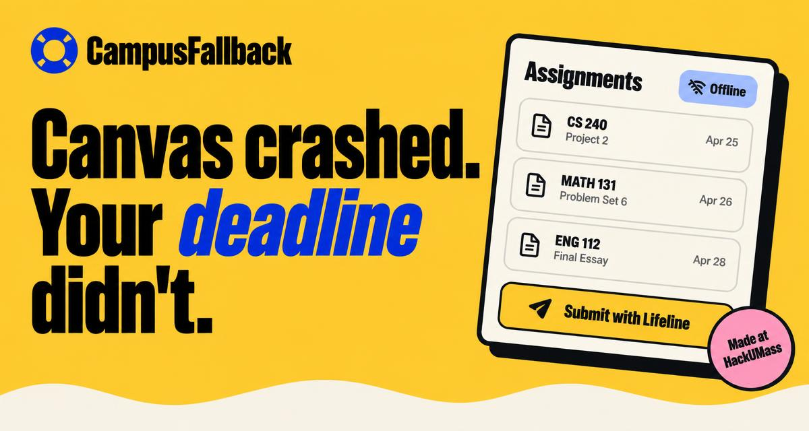
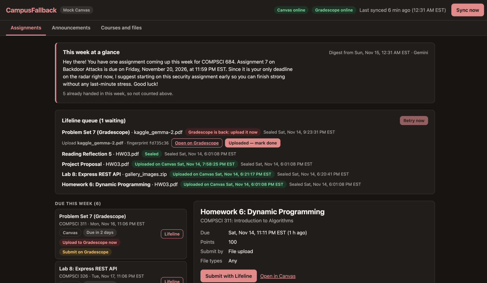
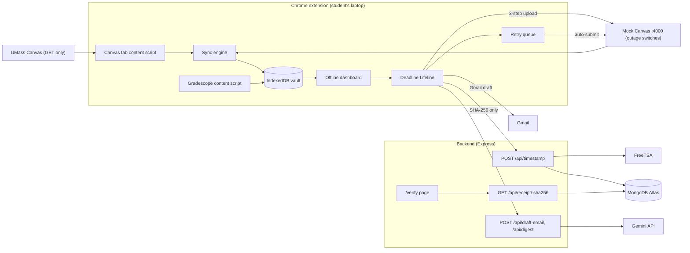

<p align="center">
  <a href="https://youtu.be/OwUUVF--JYs">
    
  </a>
  <br>
  <sub>▶️ <a href="https://youtu.be/OwUUVF--JYs">Click here to watch the demo on YouTube</a></sub>
</p>

<p align="center">
  
</p>

# CampusFallback

**A Chrome extension that keeps UMass students working when Canvas, NetID or Microsoft goes down, and protects their deadlines when it happens.**

🌐 **Live site:** [campusfallback.dev](https://campusfallback.dev/) · ▶️ **Demo video:** [youtu.be/OwUUVF--JYs](https://youtu.be/OwUUVF--JYs) · 🏆 **Devpost:** [devpost.com/software/campusfallback](https://devpost.com/software/campusfallback)

<p>
  
  
  
  
  
  
  
  
  
  
  
  
  
  
</p>

UMass Canvas logins go through NetID with Microsoft two-step verification. When Microsoft has an outage, students can be locked out of Canvas even while Canvas itself is up. That tends to happen right before something is due.

CampusFallback quietly keeps an offline copy of your courses while things work. If you can't submit near a deadline, it gives you proof that your work was finished on time, emails your professor, and submits the file for you when Canvas comes back.

Built solo in 18 hours at **HackUMass**.

---

## What it does

### 📚 Offline vault
- Syncs every 30 minutes: upcoming assignments (descriptions, due dates, allowed file types), announcements, syllabi, teacher contacts and recent course files.
- Reads **Gradescope** deadlines from course pages you open. Canvas and Gradescope entries for the same assignment are merged into one.
- The dashboard reads only from local storage (IndexedDB), so it works fully offline: no Wi-Fi, a captive portal, or a Canvas outage.
- Separate status pills for **Canvas** and **Gradescope**, checked with real timed requests rather than `navigator.onLine`.
- A **"This week at a glance"** digest written by Gemini. It leaves out work you've already handed in.

### 🛟 Deadline Lifeline
Pick an assignment and a file, then click **Submit with Lifeline**:

1. **Canvas is up:** the file is uploaded to Canvas with the same 3-step upload Canvas uses. Done.
2. **Canvas is down:** CampusFallback
   - **seals** the file: its SHA-256 fingerprint gets an RFC 3161 timestamp from **FreeTSA**, an independent clock rather than your laptop's;
   - opens a **Gmail draft to your professor**, written by **Gemini**, with a link to check the file;
   - **queues** the exact bytes it sealed and **submits them automatically** when Canvas is back, then notifies you.
3. **Gradescope assignments:** Lifeline never uploads to Gradescope. It seals and emails, then sends a notification when Gradescope is reachable again so you can upload the same file.

### ✅ Verify page
Your professor drops the submitted file on `/verify`. The file is fingerprinted **in the browser** and never uploaded, and the page shows either *"Sealed at <time>, verified by FreeTSA"* or *"No receipt found"*. An edited file, even by one byte, doesn't match. The page also offers the raw FreeTSA receipt and an `openssl` command, so anyone can check it without trusting our server.

---

## Privacy by design

- **Files and course content never leave your laptop.** The server only ever receives SHA-256 fingerprints plus short metadata (assignment names and dates for the email and digest).
- **Real Canvas is read-only.** On real Canvas the extension only makes GET requests; submissions in this build go to the mock.
- **Gradescope is never written to.** Grades and scores are never read or stored, only names, due dates and submission status.
- **The Gemini API key stays on the server**, which is rate-limited and only accepts requests from the extension and its own site.

---

## How it works



- **Local-first:** the dashboard never needs the network.
- **Real Canvas sync runs through an open Canvas tab.** The extension's own requests don't carry your Canvas login, so a content script makes same-origin GET requests from a Canvas page and hands the JSON to the extension. It allows at most 3 requests at once and backs off on Canvas rate limits.
- **Submissions start from the dashboard page**, not the service worker, because Chrome can stop a service worker mid-upload.
- **Receipts are keyed by SHA-256**, so sealing the same file twice returns the same receipt.

---

## Tech stack

| Part | Built with |
|---|---|
| Extension | Chrome Manifest V3, plain JavaScript ES modules (no bundler), Dexie over IndexedDB, WebCrypto, `chrome.alarms`, `chrome.notifications` |
| Backend | Node 20+, Express, `@google/genai` (**Gemini**), **MongoDB Atlas**, `express-rate-limit`, `openssl` for RFC 3161 timestamps |
| Proof | **FreeTSA** trusted timestamps, verified with `openssl ts -verify` |
| Landing site | React, TypeScript, Vite, Tailwind CSS, Framer Motion ([campusfallback.dev](https://campusfallback.dev/)) |
| Demo | A local mock Canvas (Express) with outage, login, lock and Gradescope switches |

---

## Run it locally

**You need:** Node 20.12 or newer, `openssl` (preinstalled on macOS and Linux), and Google Chrome.

### 1. Mock Canvas (port 4000)

```bash
cd mock-canvas
npm ci
npm start
```

### 2. Backend (port 3000)

```bash
cd server
cp .env.example .env    # add GEMINI_API_KEY and MONGODB_URI
npm ci
npm run dev
```

Both keys are optional for a quick try: without `GEMINI_API_KEY`, emails and digests use built-in templates, and without `MONGODB_URI`, receipts are kept in memory. Check it with `curl localhost:3000/api/health`.

### 3. Extension

1. Open `chrome://extensions` and turn on **Developer mode**.
2. Click **Load unpacked** and pick the `extension/` folder.
3. Pin CampusFallback, click its icon to open the dashboard, then click **Sync now**.

Which servers the extension talks to is set in [`extension/lib/config.js`](extension/lib/config.js): `TARGET` (`'mock'` or `'real'` Canvas) and `API_TARGET` (`'local'` or `'prod'` backend).

---

## Using it with real UMass Canvas and Gradescope

1. In [`extension/lib/config.js`](extension/lib/config.js), set `TARGET = 'real'` and reload the extension. Real Canvas data goes into its own local database, separate from the mock.
2. Log in to Canvas at `umamherst.instructure.com` in a tab. The extension syncs through that tab, at most every 30 minutes and whenever you click **Sync now**.
3. Under **Courses and files → Courses to sync**, the current semester is always included. Tick any other courses you want offline.
4. Open any Gradescope course page. Its deadlines are saved automatically, and **Refresh Gradescope** on that page reads all your current courses (at most once every 30 minutes).

---

## Server settings

The backend reads these from `server/.env` (copy `server/.env.example`).

| Variable | Purpose |
|---|---|
| `GEMINI_API_KEY` | Gemini key for email and digest drafts (server only) |
| `GEMINI_MODEL` | One model, or several comma-separated models to try in order |
| `MONGODB_URI` | MongoDB Atlas connection string for receipts |
| `PUBLIC_BASE_URL` | Public address used in verify links, e.g. `https://your-domain` |
| `ALLOWED_ORIGINS` | The extension origin and your domain, comma-separated |

---

## Repository layout

```
campusfallback/
├── extension/        Chrome MV3 extension
│   ├── background.js     scheduled sync, retry queue, notifications
│   ├── content/          Canvas tab sync, Gradescope deadline reader
│   ├── dashboard/        offline dashboard and Lifeline UI
│   └── lib/              sync engine, Canvas client, storage, hashing, submission, queue
├── server/           Express API and verify page
│   ├── src/              routes (receipts, Gemini) and libs (FreeTSA, MongoDB, Gemini)
│   ├── public/           landing page and /verify
│   └── certs/            FreeTSA public certificates
├── mock-canvas/      Mock Canvas API with outage switches, for the demo
└── docs/             Images
```
